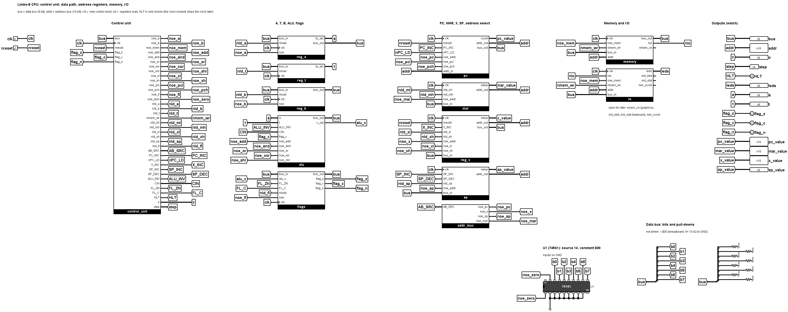
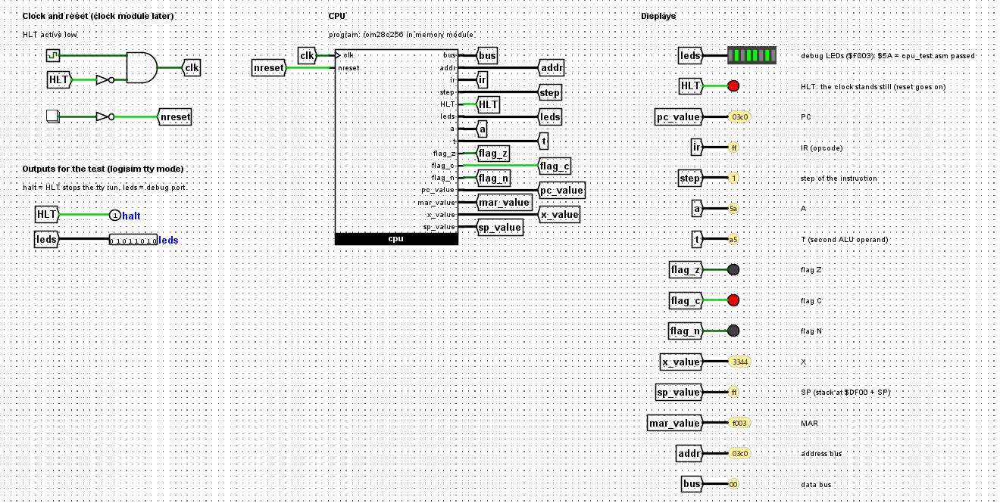

# Limbo-8

A home-built 8-bit computer made from 74HC logic chips, EEPROMs and SRAM. It is designed and simulated in [Logisim Evolution](https://github.com/logisim-evolution/logisim-evolution) 5.0.0 first and will be built on breadboards afterwards. The goal is a small computer with VGA text output, a PS/2 keyboard and a shell written in assembly.

**Status:** the CPU is complete in Logisim and runs all 77 instructions. Clock module, graphics, keyboard and the breadboard build are still to come.

## Screenshots

**The CPU:** the circuit `cpu` with the control unit, A/T/B, ALU and flags, the address registers PC, MAR, X and SP, memory and I/O.



**The computer running `cpu_test.bin`:** all 12 tests passed, the debug LEDs show `$5A` and the CPU has halted.



## How the CPU works

- **8-bit data bus, 16-bit address bus** (64 KB). Registers and ALU reach the data bus through tri-state drivers (74HC541), ROM and RAM through their own output enable; a decoder makes sure only one of them drives the data bus at a time.
- **Registers:** accumulator A, B, a 16-bit pointer X, an 8-bit stack pointer SP (stack fixed at `$DF00–$DFFF`) and the 16-bit program counter. Internally there are also the instruction register, a hidden ALU operand T and a 16-bit memory address register.
- **ALU:** add/subtract (two 74HC283), AND, OR, XOR and shift right. Each operation is its own bus source, so no result multiplexer is needed. Flags: zero, carry and negative.
- **Microcoded control unit:** the opcode, a step counter and the selected flag form the address of three 28C256 EEPROMs. Together they give a 24-bit control word per step, which is held in a latch for one clock. Every instruction starts with the same fetch step and takes 2–7 clock cycles.
- **Instruction set:** an accumulator machine in the spirit of the 6502 – loads and stores, ALU operations with immediate, absolute, `[X]` and register operands, pointer access with post-increment (`[X+]`), conditional jumps, `CALL`/`RET`, `PUSH`/`POP`.
- **Memory map:** ROM `$0000–$7FFF` (program, starts at `$0000` after reset), RAM `$8000–$DFFF`, video RAM `$E000–$EFFF` (planned), I/O `$F000–$FFFF` (debug LEDs at `$F003`).

Details: [architecture](docs/architecture.md), [instruction set](docs/instruction-set.md), [Logisim](docs/logisim-guide.md).

## Running it in Logisim

1. Install Logisim Evolution 5.0.0 (it needs Java 21+).
2. Open `logisim/limbo.circ` (keep `chips.circ` in the same folder) and select the circuit **`computer`**.
3. Set *Simulate → Auto-Tick Frequency* to 128 Hz and turn on *Simulate → Auto-Tick Enabled* (Ctrl+K).

The program ROM is empty in the repository (all `$FF` = `HLT`), so the CPU halts right away until you load a program (see below). A good first one is `software/running_light.asm`: one bit runs back and forth over the debug LEDs. `software/cpu_test.asm` is a self-test of all instructions: the debug LEDs count the tests 1 to 12, then show `$5A` and the CPU halts. The reset button restarts the program. Right click on the `cpu` → *View cpu* shows the buses and registers while it runs.

## Programming it

```
python software/asm.py software/running_light.asm
```

This gives `running_light.bin` (32 KB ROM image) and a listing. In Logisim, open the circuit `memory`, right click on the ROM → *Load Image* and pick the `.bin`, then press reset in `computer`. The assembler syntax is described in [docs/assembler.md](docs/assembler.md).

## Repository

| Folder | Contents |
|---|---|
| `docs/` | architecture, instruction set, assembler, Logisim guide |
| `logisim/` | the circuits: `limbo.circ` (one subcircuit per module) and `chips.circ` (74HC154/688, which Logisim lacks) |
| `microcode/` | the instruction table and the script that generates the EEPROM images, the Logisim ROM contents and the tables in the docs |
| `software/` | assembler and example programs |
| `emulator/` | planned |

## Generated files

Whether the microcode images, the microcode ROMs in `limbo.circ` and the tables in the docs are up to date:

```
python microcode/microcode.py --check
```
